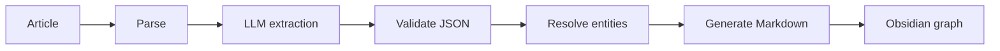

# KnowledgeWeaver

Turn articles and technical books into traceable, visual knowledge graphs.

KnowledgeWeaver is an agent-powered pipeline that extracts concepts, claims, entities, evidence, and typed relationships from source documents. The first release targets an Obsidian vault; Neo4j and Graph RAG are planned as later adapters.

## Product principles

- Evidence before inference: every extracted fact and relationship keeps its source location and supporting text.
- Human review first: generated knowledge remains editable Markdown.
- Stable intermediate format: adapters consume validated JSON rather than raw LLM output.
- Obsidian first, Neo4j second: validate extraction quality before introducing database complexity.
- Idempotent generation: processing the same document twice must not duplicate nodes.

## MVP workflow



## Planned capabilities

- Import Markdown, plain text and web-article content.
- Split documents into traceable sections.
- Extract typed nodes and relationships.
- Distinguish explicit statements from model inference.
- Validate output against a versioned JSON Schema.
- Detect duplicate entities and aliases.
- Generate Obsidian notes, YAML frontmatter and wikilinks.
- Produce validation and unresolved-item reports.
- Export to Neo4j through an optional adapter.
- Support later Graph RAG and visual exploration.

## Documentation

- [Development plan](docs/DEVELOPMENT_PLAN.md)
- [Architecture and UML](docs/ARCHITECTURE.md)
- [Features and acceptance criteria](docs/FEATURES.md)
- [Project TODO](TODO.md)

## Proposed repository layout

```text
KnowledgeWeaver/
├── docs/
├── examples/
├── prompts/
├── schemas/
├── src/knowledge_weaver/
│   ├── domain/
│   ├── ingestion/
│   ├── extraction/
│   ├── validation/
│   ├── resolution/
│   └── exporters/
├── tests/
├── TODO.md
└── pyproject.toml
```

## Delivery strategy

Phase 1 produces a local CLI and Obsidian-compatible output. Phase 2 adds multi-document deduplication. Phase 3 adds Neo4j. Phase 4 adds Graph RAG and an optional visual interface.

See the development plan for scope boundaries and definition of done.

## Status

Planning and architecture documentation are established. Implementation has not started.

## License

License selection is pending.
