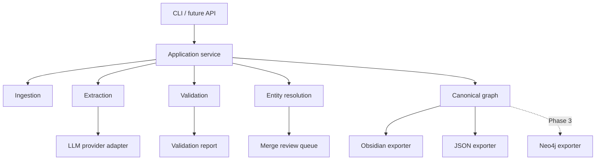
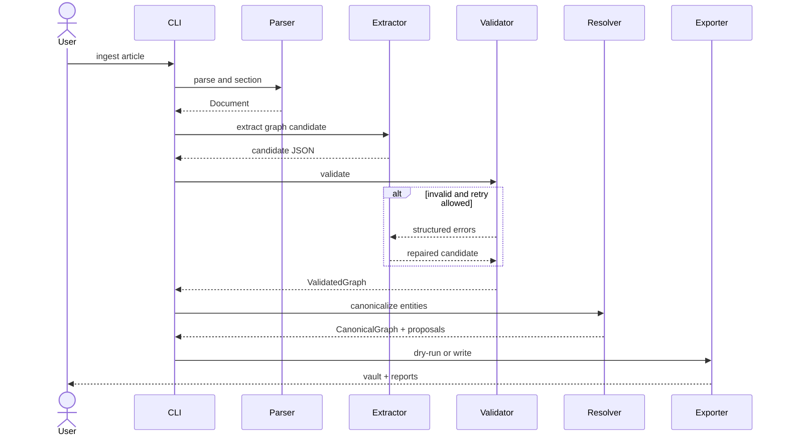
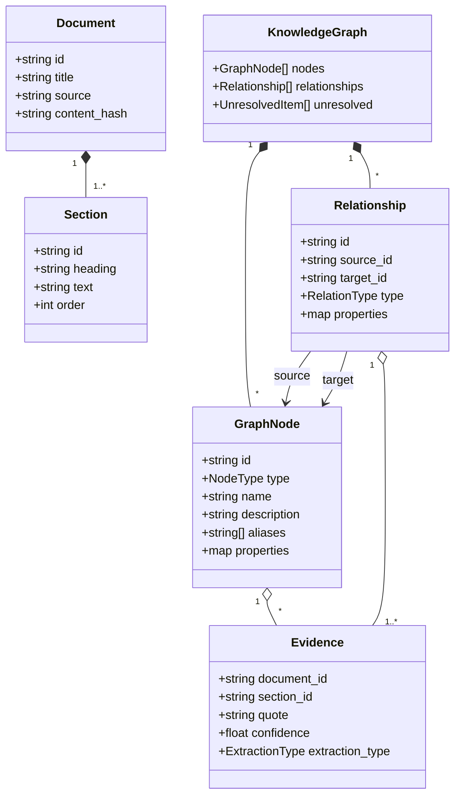
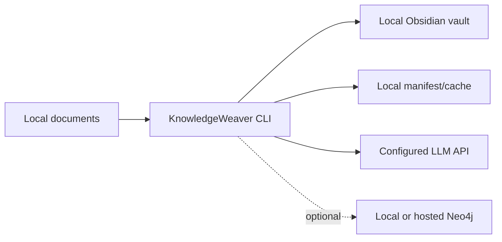

# Architecture and UML

## 1. Architectural style

KnowledgeWeaver uses a ports-and-adapters pipeline. The canonical graph is independent of the LLM provider, Obsidian and Neo4j. External systems are adapters around a validated domain model.

## 2. Component diagram



### Dependency rule

Domain and application modules must not import Obsidian, Neo4j or a specific LLM SDK. Adapters implement interfaces owned by the application layer.

## 3. Processing sequence



## 4. Domain class diagram



## 5. Module boundaries

| Module | Responsibility | Must not do |
|---|---|---|
| `ingestion` | Read and normalize input, create sections | Call an LLM |
| `extraction` | Build prompt and obtain graph candidates | Write output files |
| `validation` | Enforce schema and semantic invariants | Guess missing facts |
| `resolution` | Canonicalize names and propose merges | Silently merge ambiguity |
| `domain` | Stable models, enums and IDs | Depend on infrastructure |
| `exporters.obsidian` | Produce Markdown and wikilinks | Change canonical meaning |
| `exporters.neo4j` | Transactional graph upserts | Become the source of truth |
| `reporting` | Explain errors, uncertainty and changes | Mutate graph data |

## 6. Canonical data invariants

1. Node IDs are stable across identical normalized input.
2. Relationship endpoints must exist.
3. Relationship types and node types come from allowlists.
4. Every claim and relationship has at least one evidence record.
5. `explicit` means the evidence directly states the fact.
6. `inferred` content is visibly marked and may use a stricter threshold.
7. Confidence is between 0 and 1.
8. Low-confidence items go to `unresolved`, not the main graph.
9. Human-authored Obsidian files are never overwritten unless explicitly managed by KnowledgeWeaver.

## 7. Obsidian output model

```text
vault/
├── Articles/
├── Concepts/
├── Claims/
├── People/
├── Organizations/
├── Technologies/
├── Sources/
└── _reports/
```

Generated notes contain YAML frontmatter:

```yaml
---
kw_id: Concept_GraphDatabase
kw_type: Concept
aliases:
  - graph DB
sources:
  - Article_example
confidence: 0.94
generated_by: KnowledgeWeaver
---
```

Relations are rendered as named fields or readable sections rather than anonymous links:

```markdown
## Relationships

- depends_on:: [[Database Fundamentals]]
- used_by:: [[Neo4j]]
```

## 8. Neo4j mapping

Planned mapping:

- Each canonical node becomes a Neo4j node with a general `Entity` label and a specific type label.
- Each canonical relationship becomes a typed Neo4j relationship.
- Provenance is retained through properties initially; dedicated Evidence nodes may be introduced if cross-source evidence queries justify them.
- `id` is unique and used for `MERGE`.
- Writes occur in transactions after canonical graph validation.

## 9. Deployment view



The MVP is local-first. Only the selected document content is sent to the configured LLM provider. Offline extraction can be added through a local-model adapter.

## 10. Security boundaries

- API keys are loaded from environment variables or an ignored local configuration file.
- Logs redact credentials and avoid complete source content.
- Input documents are untrusted data, not instructions.
- Export paths are restricted to the configured output root.
- Writes use temporary files followed by atomic replacement.
- Obsidian Local REST API integration, if added, is optional and bound to localhost by default.
